# BC2RL: signal, transfer and retention after behavior cloning — initial study

**Status: FINAL DRAFT (2026-10-25 23:14 EDT).** All runs are complete. The result set was frozen at commit `22e6816` (owner
amendment A4, 2026-10-25 22:55 EDT); the test split was then read once (analysis job 10932504). Sections say which
split each number comes from. One analysis after the test read is labelled **post hoc** (Section 8.2).

## 1. Summary

This study tests three hypotheses with Qwen2.5-0.5B-Instruct (LoRA r16) on a verifiable arithmetic task with
3, 5 and 10 inputs (2, 4 and 9 operations):

| hypothesis | experiment | status |
|---|---|---|
| H1: signal availability does not fully determine transfer | E2 matched-update pairs at fixed BC checkpoints | **E2 not run**: pre-launch check failed (Section 6); E0 + observational E3 only |
| H2: aggregate improvement can conceal loss of existing competence | E3 retention on initially consistent problems | pre-registered test measurable only for extended-BC seed 33 on test (n = 13): **no loss** (pass@1 +0.19 / +0.21); elsewhere measurement-limited (n < 12). Aggregate gains hide a 3-input coverage loss (Section 8) |
| H3: directional constraints preserve competence beyond shrinking | E4 projection vs norm-matched vs sham | **not run**: validation gate not met (0/3 seeds; Section 8) |

Main results (validation and test agree unless stated):
- The untouched model is at the floor (dev pass@1 2.2% / 0% / 0% for 3 / 5 / 10 inputs).
- Behavior cloning (BC) creates distinct initial profiles at 3 and 5 inputs. 10 inputs stays at or near zero
  for every checkpoint measured. The study therefore cannot test long-horizon (9-operation) learning.
- All 12 online branches (light/extended BC x GRPO/filtered x 3 seeds) raise pass@1 (test +0.07 to +0.13) and
  pass^15 (test +0.06 to +0.12); simultaneous 95% bands over k exclude zero in 24/24 test checks. Overall pass@15
  does not change (test: 11/12 bands include zero; extended-grpo-s22 -0.069).
- The aggregate hides a redistribution. At 3 inputs pass@15 falls in 12/12 test branches (-0.06 to -0.27) while
  pass^15 rises; at 5 inputs pass@15 rises in 12/12 (+0.04 to +0.21). Online training makes some problems reliable
  and stops solving others.
- On initially consistent problems (pre-registered retention test) there is no loss: where it is measurable
  (extended-BC seed 33, test, n = 13), pass@1 rises by +0.19 (GRPO) and +0.21 (filtered). The loss is among
  partly solved problems.
- Problems lost at 3 inputs: extended-BC branches exceed a no-change reference in 6/6 (test) and 5/6 (validation);
  light-BC in 3/6 and 1/6. **Post hoc**, at the same initial success count, extended-BC branches lose more problems
  than light-BC branches (test 132 vs 84 expected at light-BC rates; validation 55 vs 29), with both methods.
- GRPO and filtered supervision do not differ consistently (test: 5 of 24 band checks exclude zero, in both directions).
- Likelihood of the reference solutions on held-out problems falls in all 12 branches (-0.07 to -0.15), more for
  filtered BC. At 3 inputs it falls less for extended-BC branches, which lose more problems: this drift does not
  explain the coverage loss (Section 8.1; descriptive).

## 2. What changed (protocol amendment A2)

The first study (frozen 2026-10-24, commit `5deefef`) asked which initialization and online method performs
best. Amendment A2 (2026-10-25, `protocol/AMENDMENT-A2-2026-10-25.md`) changes the emphasis to the mechanism
question: *when initial policies give comparable success/failure signals, what decides whether an online
update transfers to other problems or damages existing competence?* The amendment keeps all valid runs,
the frozen task, data, model, decoding, loss and round budget. It removes the no-BC online arms (none ran) and
adds E0, E2, the retention analysis, 15-attempt validation panels and the full pass@k / pass^k grid
(k = 1..15). Section 10 lists every deviation.

Evidence classes used in this report:
- **Established mathematics:** estimators, mixed-group probability, the GRPO group coefficient, the E0 counterexample.
- **Observational evidence:** E3 trajectories and retention transitions.
- **Intervention evidence:** E2 (and E4 if run).

The existence of intermediate-probability learning signals and of gradient interference is prior work [5, 7, 8, 10, 11],
not a finding of this study.

## 3. Setup

| item | value |
|---|---|
| model | Qwen2.5-0.5B-Instruct @ `7ae5576`, BF16; LoRA r16 / alpha 32 / dropout 0 on q,k,v,o,gate,up,down (8,798,208 parameters) |
| task | n positive integers 2-20 and a target <= 1000; exactly n-1 lines `a op b = c` (+, -, *); exact verifier; reward 1 only for full success |
| data (v1) | dev 144, devdemo 512, BC 2,048, online 4,096, validation 144, test 288 (balanced by input count); mechanism splits anchor-fit / anchor-check / probe 48 each (new draws, same generator) |
| BC | AdamW 1e-4, batch 32, stratified order; light = 16 steps (0.25 epoch), extended = 128 steps (2 epochs); seeds 11, 22, 33 |
| online | 32 prompts x G = 4 completions per round, 256 rounds, one AdamW step per round (lr 1e-5), fresh optimizer at the fork; GRPO (group-standardized, clip 0.2, KL 0, ratio 1 by construction) or filtered supervision (successful fresh outputs only) |
| decoding | temperature 1, top-p 1, top-k off, repetition penalty 1, cap 256 tokens; one fixed format example in every prompt |
| evaluation | test 288 x 15 attempts; validation 144 x 4 (curves) and 144 x 15 (initial and round-256 panels) |
| compute | Babel `preempt` GPUs only, at most 5 concurrent BC2RL GPUs |

## 4. Task suitability (dev and validation; Section A of the plan)

### 4.1 Untouched model, dev, 15 attempts, format prompt (job 10915835)

| inputs | pass@1 | pass@4 | pass^4 | format valid | truncated | problems with >= 1 success |
|---|---:|---:|---:|---:|---:|---:|
| 3 | 0.022 | 0.077 | 0 | 0.722 | 0.042 | 9/48 |
| 5 | 0 | 0 | 0 | 0.713 | 0.043 | 0/48 |
| 10 | 0 | 0 | 0 | 0.579 | 0.110 | 0/48 |

The dominant failure is `illegal_operand` (an unavailable number or a reused input). An independent re-scorer
agrees with the verifier on 6,480 / 6,480 baseline attempts.

### 4.2 Learnability (disposable dev BC path, seed 7, dev 15 attempts)

| BC steps | pass@1 3 / 5 / 10 inputs | 5-input problems solved |
|---:|---|---:|
| 0 | 0.022 / 0 / 0 | 0/48 |
| 16 | 0.097 / 0.004 / 0 | 3/48 |
| 128 | 0.307 / 0.028 / 0 | 12/48 |

The pre-registered gate (5-input pass@1 >= 2% with >= 5/48 solved) passed. The generator was not revised.

### 4.3 Main BC checkpoints, validation 144 x 4 attempts

| seed | light (16) | extended (128) | continued BC (256) |
|---|---:|---:|---:|
| 11 | 0.031 | 0.118 | 0.139 |
| 22 | 0.038 | 0.097 | 0.158 |
| 33 | 0.040 | 0.151 | 0.141 |

10-input validation pass@1 is <= 0.005 for every checkpoint.

### 4.4 Audit by input count (validation 144 x 4; range over seeds 11 / 22 / 33)

| inputs | quantity | light BC | extended BC | continued BC |
|---:|---|---|---|---|
| 3 | pass@1 | 0.089-0.115 | 0.271-0.411 | 0.380-0.422 |
| 3 | problems with a mixed 4-attempt group | 0.31-0.40 | 0.63-0.67 | 0.60-0.73 |
| 5 | pass@1 | 0-0.010 | 0.010-0.042 | 0.036-0.047 |
| 5 | problems with a mixed 4-attempt group | 0-0.04 | 0.04-0.15 | 0.13-0.19 |
| 10 | pass@1 | 0 | 0 | 0-0.005 |
| 10 | problems with a mixed 4-attempt group | 0 | 0 | 0-0.02 |

- The dominant light-BC failure is an illegal operand (an unavailable or reused number): 0.54-0.89 of attempts.
  After extended or continued BC, the dominant failure at 3 and 5 inputs is a legal chain with a wrong final value.
- Format validity is >= 0.75 for every BC checkpoint (untouched model: 0.57-0.72).
- Light BC truncates often at 10 inputs (256-token cap): 0.03, 0.29 and 0.67 of attempts for seeds 22, 11 and 33.
  Some 10-input failures of light BC are therefore length failures, not only arithmetic failures.
- Consequence: GRPO receives almost all of its signal from 3-input problems, some from 5-input problems and none from
  10-input problems. The study cannot test long-horizon learning. Source: `audit.csv` (analysis code, commit 26eae27).

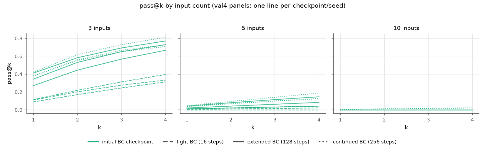

## 5. E0: exact two-task model (analytic control)

E0 is mathematics, not a measurement. Two tasks share one parameter theta. In the *aligned* model both tasks
improve together; in the *opposing* model one task improves while the other degrades. At theta = 0 both models have
identical success curves and identical mixed-group probabilities, but the full-batch policy gradient is 0.25 in the
aligned model and exactly 0 in the opposing model. In the opposing model, mean success (pass@1) stays at 0.5 for
every theta, while pass@k falls and pass^k rises for every k > 1. A success profile alone therefore cannot determine
whether an update transfers, and pass@1 alone can hide a change in competence. All numeric checks pass (CPU job
10921829): estimator bias <= 1e-15, GRPO and mixed-group identities exact to 2e-16, Taylor residual ratio <= 0.045.

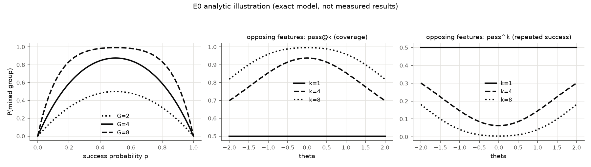

## 6. E2: matched-update intervention (H1) — not run

**E2 was not run as an intervention.** Its pre-registered pre-launch check failed at the calibrated radius, and the
decision rule fixed before the diagnostic (amendment Section 11) excludes the experiment. This is a
measurement-limited result. The design is unchanged (amendment Section 4): matched high- vs low-alignment GRPO
minibatches, equal-norm actual AdamW displacements, one radius, and the paired anchor-check log-likelihood change.

What happened (development data only; dev light-BC checkpoint, seed 7):
- The radius rule chose rho = 1, which is one real AdamW step (median sampled-token KL 0.0048; 0.021 at rho = 2).
- The Taylor check compares the actual anchor-fit log-likelihood change with the first-order prediction h.d. It needs
  a ratio in [0.5, 2]. In the BF16 model the ratios were 0.20, 4.45, 0.24 and 13.7.
- A diagnostic (job 10925931) separated three causes:
  - **Implementation:** correct. In fp32, four random directions of equal norm follow h.d with ratio 0.96-1.03.
  - **Measurement floor:** the BF16 forward pass changes the anchor log-likelihood by up to 2.5e-4 for random
    directions whose true effect is < 2.4e-6. A one-step effect (2.5e-5 to 1.9e-4) is at or below this floor.
  - **Curvature:** in fp32 the ratios are 0.83, 1.40, 0.70 and 2.89. A fit a*rho + b*rho^2 recovers the predicted
    linear term (a / h.d = 0.62-1.06), but every GRPO displacement has a negative second-order term
    (b = -3.5e-5 to -5.4e-5), about 10^4 times the value for random directions. For the low-alignment update with the
    smallest predicted change, this term is about twice the predicted first-order term after one step.

Interpretation, limited to these 4 displacements on one development checkpoint: first-order alignment with the anchor
gradient does not by itself predict the one-step anchor change of a GRPO update, because the update also lies along
high-curvature directions of the anchor objective. This is descriptive and does not test H1.

| displacement | alignment cos(h, d) | predicted h.d | actual (fp32) | ratio | fitted b |
|---|---:|---:|---:|---:|---:|
| pair 0, high | +0.059 | +1.72e-4 | +1.43e-4 | 0.83 | -3.5e-5 |
| pair 0, low | -0.035 | -1.12e-4 | -1.58e-4 | 1.40 | -4.9e-5 |
| pair 1, high | +0.047 | +1.53e-4 | +1.07e-4 | 0.70 | -4.9e-5 |
| pair 1, low | -0.009 | -2.46e-5 | -7.12e-5 | 2.89 | -5.4e-5 |

Source: `results/bc2rl-e2-taylordiag-dev-s7/taylor_diag.json`, calibration `runs/bc2rl-e2-calib-devlight-s7/calibration.json`.

## 7. E3: online trajectories and paired method comparison

All 12 branches are complete (jobs 10917856, 10921467-70, 10926005; commits 5deefef / 90db8b9 / 7eac985 with
identical E3 code). Every branch ran 256 rounds from an initial adapter whose sha256 matches Stage 1. Rounds without
a mixed group give no GRPO step: GRPO took 250 / 250 / 238 steps from light BC and 255 / 254 / 253 from extended BC
(seeds 11 / 22 / 33); filtered supervision took 256 steps in every branch. Test evaluations of every branch were read once,
after the result freeze (Section 7.2).

The learning signal is sparse. For light-grpo-s11, on average only 4.2, 3.7, 3.2 and 2.9 of 32 groups were mixed in
rounds 1-64, 65-128, 129-192 and 193-256; about 26 groups failed completely throughout. Light-BC branches have fewer
mixed groups than extended-BC branches during most of training (figure, left).

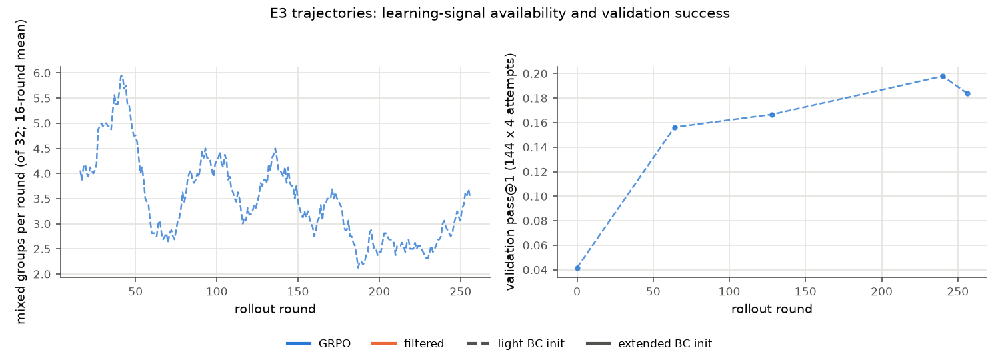

### 7.1 Validation endpoint (val15: 144 problems x 15 attempts, initial and round-256 adapters)

| branch | pass@1 gain [simultaneous 95%] | pass^15 gain | pass@15 gain | pass@15 gain at 3 inputs |
|---|---|---|---|---|
| light-grpo s11 / s22 / s33 | +0.150 / +0.169 / +0.125 | +0.104 / +0.132 / +0.111 | -0.014 / +0.062 / +0.007 | -0.083 / -0.021 / -0.125 |
| light-filtered s11 / s22 / s33 | +0.163 / +0.147 / +0.165 | +0.111 / +0.111 / +0.153 | +0.007 / +0.076 / +0.042 | -0.125 / +0.042 / +0.021 |
| extended-grpo s11 / s22 / s33 | +0.090 / +0.129 / +0.097 | +0.139 / +0.146 / +0.132 | -0.049 / +0.000 / +0.042 | -0.188 / -0.167 / -0.125 |
| extended-filtered s11 / s22 / s33 | +0.106 / +0.110 / +0.102 | +0.146 / +0.125 / +0.132 | -0.049 / +0.014 / -0.014 | -0.271 / -0.188 / -0.167 |

Every pass@1 and pass^15 gain has a simultaneous band that excludes zero. Every overall pass@15 band includes zero
except light-filtered-s22 (+0.076 [+0.014, +0.139]). The 3-input column is a point estimate (no per-stratum band).
Bands and all k = 1..15 are in `results/bc2rl-an-val2-main-s0/contrasts.csv`.

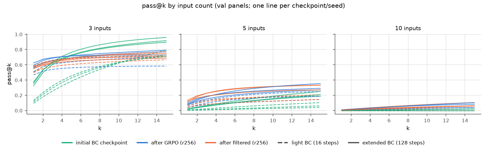
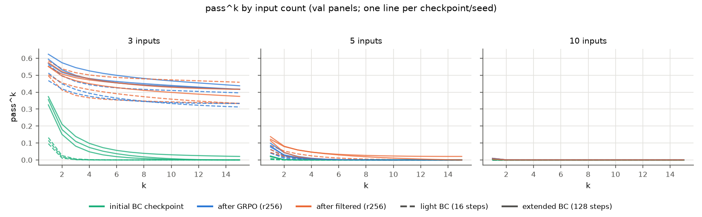

At 3 inputs the initial extended-BC adapters have the highest coverage (pass@15 about 0.9-0.96) and the lowest
reliability; after either online method both curves flatten near 0.6-0.8. The number of 3-input problems solved in
all 15 attempts rose from 0-1 to 15-22 of 48 in every branch. 10 inputs stays at the floor (pass@1 <= 0.010 in all 36
validation panels).

GRPO minus filtered (same initial adapter and seed): 17 of 18 contrasts (pass@1, pass@15, pass^15 x 6 pairs) have
simultaneous bands that include zero. The exceptions point in opposite directions: light-s33 pass^15 -0.042
[-0.080, -0.004]; extended-s33 pass@15 +0.056 [0.000, +0.111]. The validation data show no consistent method effect.

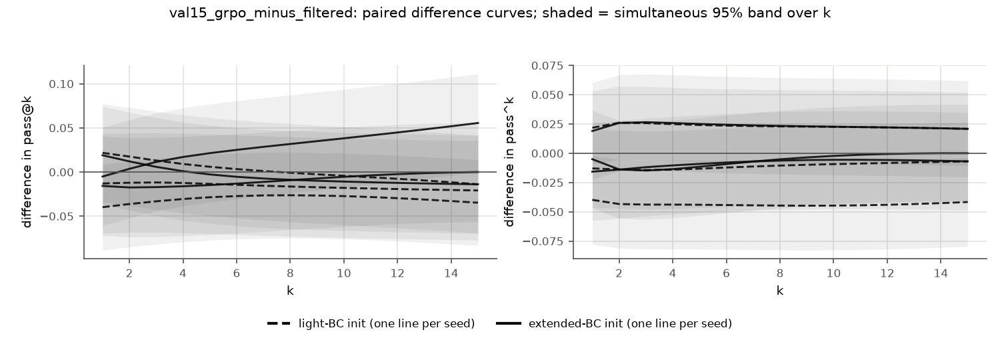

### 7.2 Test endpoint (288 problems x 15 attempts; read once after the freeze)

| branch | pass@1 gain | pass^15 gain | pass@15 gain | pass@15 gain at 3 inputs | pass@15 gain at 5 inputs |
|---|---|---|---|---|---|
| light-grpo s11 / s22 / s33 | +0.120 / +0.113 / +0.094 | +0.073 / +0.066 / +0.069 | +0.038 / +0.021 / -0.042 | -0.094 / -0.094 / -0.188 | +0.208 / +0.135 / +0.062 |
| light-filtered s11 / s22 / s33 | +0.112 / +0.107 / +0.129 | +0.083 / +0.066 / +0.094 | +0.017 / +0.042 / -0.000 | -0.188 / -0.062 / -0.146 | +0.208 / +0.177 / +0.135 |
| extended-grpo s11 / s22 / s33 | +0.073 / +0.093 / +0.081 | +0.090 / +0.111 / +0.090 | -0.028 / -0.069 / -0.031 | -0.156 / -0.271 / -0.229 | +0.042 / +0.042 / +0.104 |
| extended-filtered s11 / s22 / s33 | +0.093 / +0.101 / +0.085 | +0.080 / +0.062 / +0.118 | +0.010 / +0.007 / -0.021 | -0.156 / -0.198 / -0.260 | +0.115 / +0.177 / +0.135 |

Every pass@1 and pass^15 gain has a simultaneous band that excludes zero (24/24). Overall pass@15 bands include zero
except extended-grpo-s22 (-0.069 [-0.122, -0.017]). The per-input columns are point estimates. Source:
`results/bc2rl-an-finalp1-main-s0/contrasts.csv`. 10 inputs stays at the floor (test pass@1 <= 0.006 in every panel).

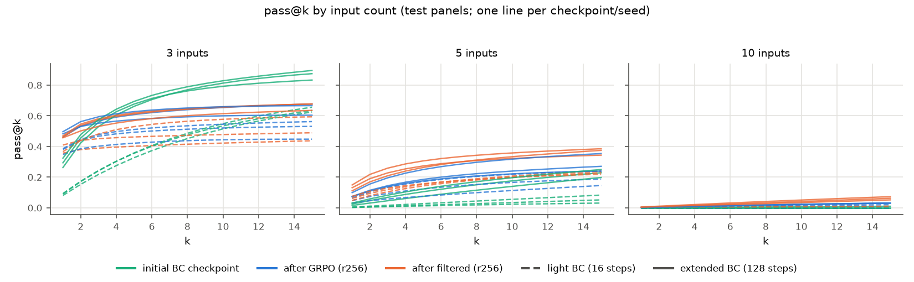
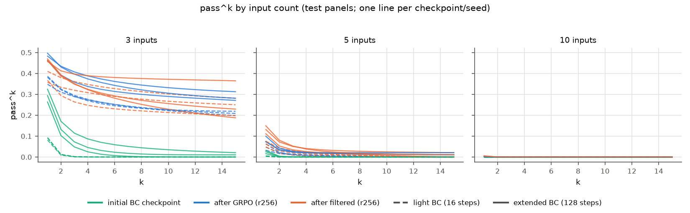

The test curves repeat the validation pattern. After either method, the 3-input pass@k curves flatten after k = 4:
the final policies solve some problems in almost every attempt and others in none. At 5 inputs coverage rises.

GRPO minus filtered on test: 5 of 24 checks (pass@1, pass@15, pass^1, pass^15 x 6 pairs) exclude zero, in both
directions: extended-s11 pass@15 -0.038, extended-s22 pass@15 -0.076 but pass^15 +0.049, light-s33 pass@15 -0.042
and pass@1 -0.035. There is no consistent method effect.

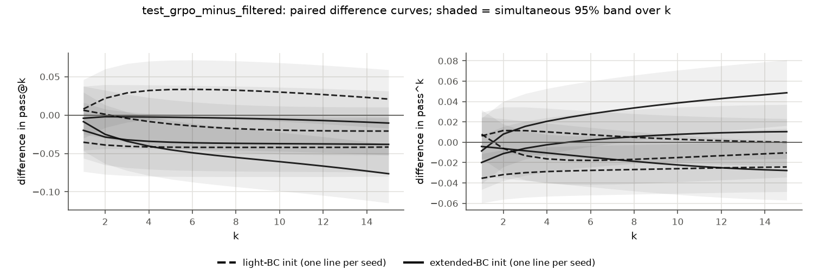

## 8. Retention (H2), coverage loss and the E4 gate

Pre-registered rule (amendment Section 5): attempts 1-7 of the initial 15-attempt evaluation define the initially
consistent subgroup (>= 6/7); attempts 8-15 give an independent baseline; the final adapter gets 15 fresh attempts.
Retention claims use k = 1..8 and need >= 12 problems per stratum.

**Validation result: measurement-limited.** The subgroup has 0 problems for every light-BC branch and 3-5 problems
(all at 3 inputs) for the extended-BC branches. No branch reaches 12. On these few problems the final success rate
is higher than the baseline (pass@1 +0.20 to +0.29), so the data give no sign of loss among consistent problems, and
no power to detect it.

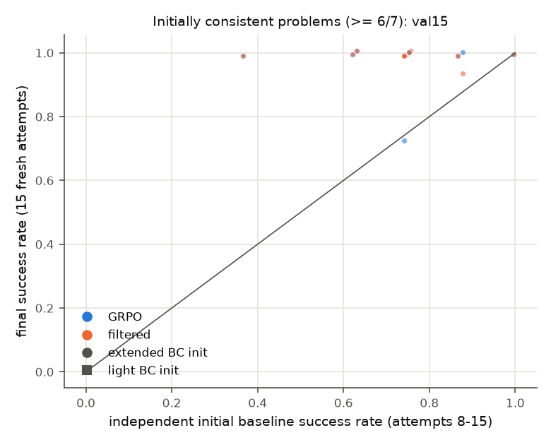

**Test result (288 x 15).** The subgroup has 0 problems for every light-BC branch and 5 / 2 / 13 problems (all at 3
inputs) for extended-BC seeds 11 / 22 / 33. Only extended-BC seed 33 reaches 12, for both methods:

| branch (n = 13) | pass@1 baseline -> final | difference [95%] | pass^8 baseline -> final |
|---|---|---|---|
| extended-grpo-s33 | 0.788 -> 0.979 | +0.191 [+0.079, +0.302] | 0.308 -> 0.888 |
| extended-filtered-s33 | 0.788 -> 1.000 | +0.212 [+0.115, +0.308] | 0.308 -> 1.000 |

Where the pre-registered test is measurable, consistent competence is not lost; it becomes more reliable. Most points
lie above the diagonal; the largest fall is one problem to 0.13 (filtered, baseline 0.75). The other branches stay measurement-limited.

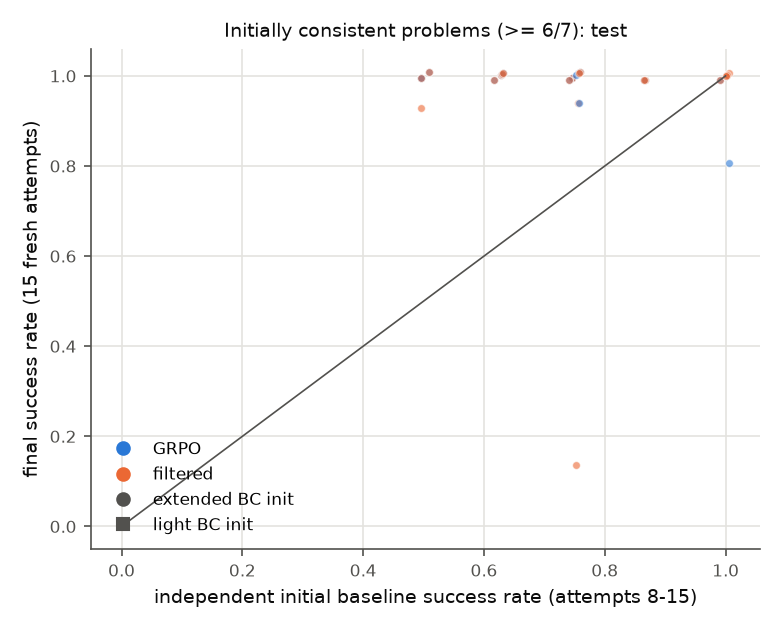

**E4 gate:** at least 2 extended-BC GRPO seeds with >= 12 consistent problems and a pass@1 fall >= 5 points. Result:
0/3 seeds. E4 is not run ("mechanism not established; subgroup too small to measure").

**Exploratory X1: coverage loss (defined 2026-10-25 15:42 EDT after the validation look, before any test read).**
A problem is *lost* when the initial adapter solved it at least once in 15 attempts and the round-256 adapter
solved it in none of 15. The reference "no change" draws each problem's rate from its Jeffreys posterior
(Beta(c + 1/2, 15 - c + 1/2)); the band is the 95% range of 10,000 simulations. 3-input validation results:

| initial BC | method | lost / initially solvable (s11, s22, s33) | expected [95% band] |
|---|---|---|---|
| extended | GRPO | 10/46, 9/43, 7/44 | 3.7 [1,7], 3.4 [1,7], 3.8 [1,7] |
| extended | filtered | 13/46, 9/43, 10/44 | same |
| light | GRPO | 8/38, 8/35, 10/34 | 9.3 [5,14], 6.3 [2,11], 5.0 [1,9] |
| light | filtered | 12/38, 5/35, 6/34 | same |

Extended-BC branches lose more problems than the reference in 5 of 6 branches (the sixth is at the band edge), with
both methods. Light-BC branches stay inside the band in 5 of 6. Limits: the reference depends on its prior (it is
calibrated only when true rates follow Beta(1/2, 1/2); for gains at 5 inputs it is clearly miscalibrated), the
analysis was chosen after seeing validation data, and it is observational. It describes where coverage was lost; it
does not identify why.

**X1 on test (rule fixed before the test read).** 3 inputs:

| initial BC | method | lost / initially solvable (s11, s22, s33) | expected [95% band] | gained / initially unsolved | expected |
|---|---|---|---|---|---|
| extended | GRPO | 18/80, 30/84, 23/86 | 5.7 [2,10], 8.2 [4,13], 8.2 [4,13] | 3/16, 4/12, 1/10 | 4.6, 3.5, 2.9 |
| extended | filtered | 19/80, 24/84, 25/86 | 5.7 [2,10], 8.2 [4,13], 8.2 [4,13] | 4/16, 5/12, 0/10 | 4.6, 3.5, 2.9 |
| light | GRPO | 18/60, 18/63, 25/61 | 13.0 [7,19], 12.8 [7,19], 12.0 [7,18] | 9/36, 9/33, 7/35 | 10.4, 9.6, 10.1 |
| light | filtered | 26/60, 15/63, 23/61 | 13.0 [7,19], 12.8 [7,19], 12.0 [7,18] | 8/36, 9/33, 9/35 | 10.4, 9.6, 10.1 |


Extended-BC branches lose more than the reference in 6 of 6 branches; light-BC branches in 3 of 6. At 3 inputs the
gain counts are close to the reference, so the reference is roughly calibrated there (at 5 inputs it over-predicts
gains, as on validation). As a share of initially solvable problems, the two inits lose a similar fraction
(extended 0.23-0.36, light 0.24-0.43), because the reference expects fewer losses from extended-BC adapters, which
solve more problems often. Section 8.2 removes the reference.

### 8.2 Post hoc: loss at the same initial success count

This analysis was defined after the test read (DECISIONS 2026-10-25 23:08 EDT). It compares the loss rate of
light-BC and extended-BC branches among 3-input problems with the same initial success count c (of 15), with seeds
pooled. It needs no prior. Script `scripts/x1_by_initial_c.py` (job 10932586).

| split | method | extended-BC lost (shared c) | expected at light-BC per-c rates |
|---|---|---:|---:|
| test | GRPO | 68 | 39.8 |
| test | filtered | 64 | 44.3 |
| validation | GRPO | 25 | 17.8 |
| validation | filtered | 30 | 11.5 |

Test loss rate by c, extended vs light (pooled methods): c = 1: 0.63 vs 0.44; c = 2: 0.56 vs 0.35; c = 3: 0.31 vs
0.26; c = 4: 0.29 vs 0.11; c = 5: 0.24 vs 0.14. The direction is the same in all 5 shared bins on test and on
validation. At the same initial success count, problems are lost more often after extended BC, with both online
methods. Limits: post hoc; no uncertainty band (the same problems appear in all seeds, so pooled counts are not
independent); light-BC adapters have almost no problems above c = 5; observational, so the cause is not identified.

### 8.1 Anchor-trace likelihood along the E3 trajectories (pre-registered secondary diagnostic; descriptive)

For each branch, an fp32 forward pass measures the mean normalized log-likelihood of the reference traces of 48
held-out anchor-check problems (16 per input count; mechanism split, no validation or test data) at rounds 0, 64,
128 and 256 (job 10928308, `scripts/e3_anchor_audit.py`). A repeated measurement differs by 0.0.

| initial BC | method | change r0 -> r256, all (mean [min, max] over 3 seeds) | 3 inputs | 5 inputs | 10 inputs |
|---|---|---|---:|---:|---:|
| light | GRPO | -0.075 [-0.080, -0.072] | -0.057 | -0.079 | -0.090 |
| light | filtered | -0.103 [-0.133, -0.068] | -0.052 | -0.114 | -0.144 |
| extended | GRPO | -0.097 [-0.116, -0.084] | -0.036 | -0.097 | -0.157 |
| extended | filtered | -0.123 [-0.145, -0.111] | -0.036 | -0.124 | -0.208 |

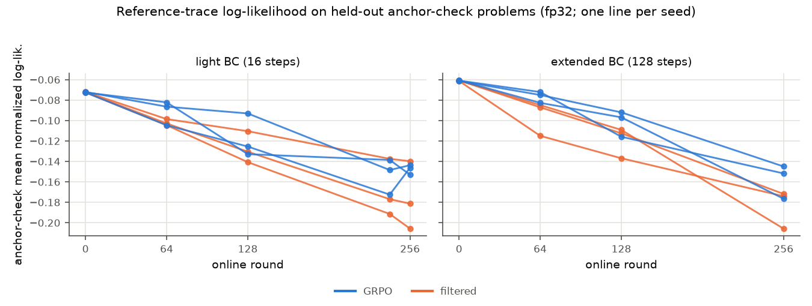

All 12 branches move away from the reference traces. The fall is mostly on numeric tokens, grows with input count,
and is larger for filtered BC than for GRPO in the group means (4 of 6 seed pairs). It does not follow the coverage
loss of X1: at 3 inputs the extended-BC branches lose less reference-trace likelihood than the light-BC branches, but
they lose more 3-input problems. Reference-trace drift therefore does not explain the coverage loss. Three seeds, no
uncertainty band; descriptive only.

## 9. Compute

| component | GPU-hours | source |
|---|---:|---|
| consumed before amendment A2 (Stage 0, Stage 1, one branch, base test eval) | 4.08 | sacct + cost ledger |
| E3 workers w1-w5 (11 branches, 3 BC-path test evals, 15 val15 evals; incl. preempted segments) | 9.35 | sacct 2026-10-25 15:49 |
| E2 calibration + Taylor diagnostic | 0.28 | sacct |
| E3 anchor audit (2 preempted segments, 2:16 + 0:43 min) | 0.05 | sacct 2026-10-25 18:30 |
| total allocated GPU-hours, all BC2RL GPU jobs | 13.80 | sacct |
| CPU-only jobs (analysis, data, tests, A3 export/migration) | not GPU-accounted | `preempt_cpu_qos` |

## 10. Deviations, missing runs and limitations

Planned deviations are in the amendment, Section 10. This table gives the outcome of each planned arm.

| arm | status | reason / record |
|---|---|---|
| E0 exact two-task model | done | Section 5 |
| E2 matched-update intervention (H1) | not run | pre-launch Taylor check failed at a one-step radius; rule 2 of D-E2-1 (amendment Section 11), fixed before the diagnostic ran |
| E3, 12 branches | done | 256 rounds in every branch; optimizer steps 238-256 (the frozen procedure skips the step in a round with no mixed group for GRPO or no success for filtered BC; light-GRPO-s33 skipped 18) |
| E3 no-BC branches (6) | not run | deferred by amendment A2; cancelled before start |
| retention test (H2) | measurable for 2 of 12 branches on test (extended-BC s33: no loss); measurement-limited elsewhere | consistent subgroup < 12 problems in the other branches and on validation |
| E4 projection (H3) | not run | pre-registered gate met by 0 of 3 seeds |
| per-round anchor audit | partly done | anchor log-likelihood at saved adapters done (Section 8.1); the audit-batch alignment was not run |
| X1 coverage loss | exploratory | defined after the validation look, before any test read (DECISIONS 2026-10-25 15:42) |
| loss by initial success count (8.2) | post hoc | defined after the test read (DECISIONS 2026-10-25 23:08) |
| result freeze | moved earlier | owner amendment A4: freeze 2026-10-25 22:55 EDT instead of Tue 15:00 |

**Limitations.**
- One model (Qwen2.5-0.5B-Instruct, LoRA r16) and one synthetic task family. No claim of generality.
- The 10-input stratum stays at floor in every panel. The study makes no long-horizon claim.
- Three seeds per cell. Seed-level differences between GRPO and filtered BC are mostly inside their bands.
- All mechanism evidence is observational (E2 and E4 did not run). No causal mechanism is claimed.
- X1 and Section 8.1 were defined after the validation results were seen; X1 was then tested once on test. Section 8.2
  was defined after the test read and has no independent confirmation.
- Laptop work under amendment A3 was CPU analysis and report writing only; no model runs used laptop hardware.

**Proposed follow-up (not started).** The post hoc result of Section 8.2 is the main open question. A confirmatory
test would pre-register it before any new data are seen: hypothesis "at the same initial success count, extended-BC
adapters lose more partly solved 3-input problems than light-BC adapters"; fresh problems from the same generator
with a new seed; the existing 12 E3 branches (no new training); per-seed estimates with a band that accounts for
shared problems (problem-level bootstrap); the comparison and threshold fixed in advance. This study did not start it.

## 11. Reproduction

```
python -m bc2rl generate  --config configs/data_v1.yaml
python -m bc2rl bc        --config configs/main/bc-broad-s{11,22,33}.yaml
python -m bc2rl online    --config configs/main/on-{light,extended}-{grpo,filtered}-s{seed}.yaml
python -m bc2rl evaluate  --config configs/main/eval-*.yaml | configs/amend1/val15-*.yaml
python -m bc2rl toy       --config configs/mech/toy.yaml
python -m bc2rl mechdata  --config configs/mech/mechdata.yaml
python -m bc2rl mech      --config configs/mech/calib.yaml ; configs/mech/e2-{light,extended}-s{seed}.yaml
python -m bc2rl analyze   --config configs/analysis/final.yaml
python scripts/e3_anchor_audit.py --config configs/mech/calib.yaml --out <dir>
python scripts/plot_anchor_audit.py --audit <dir>/anchor_audit.json --out <dir>
python scripts/x1_by_initial_c.py --config configs/analysis/final.yaml --out <dir>   # post hoc
```

## References

Numbering follows the revised proposal (`protocol/bc2rl_signal_transfer_retention_proposal.pdf`).
